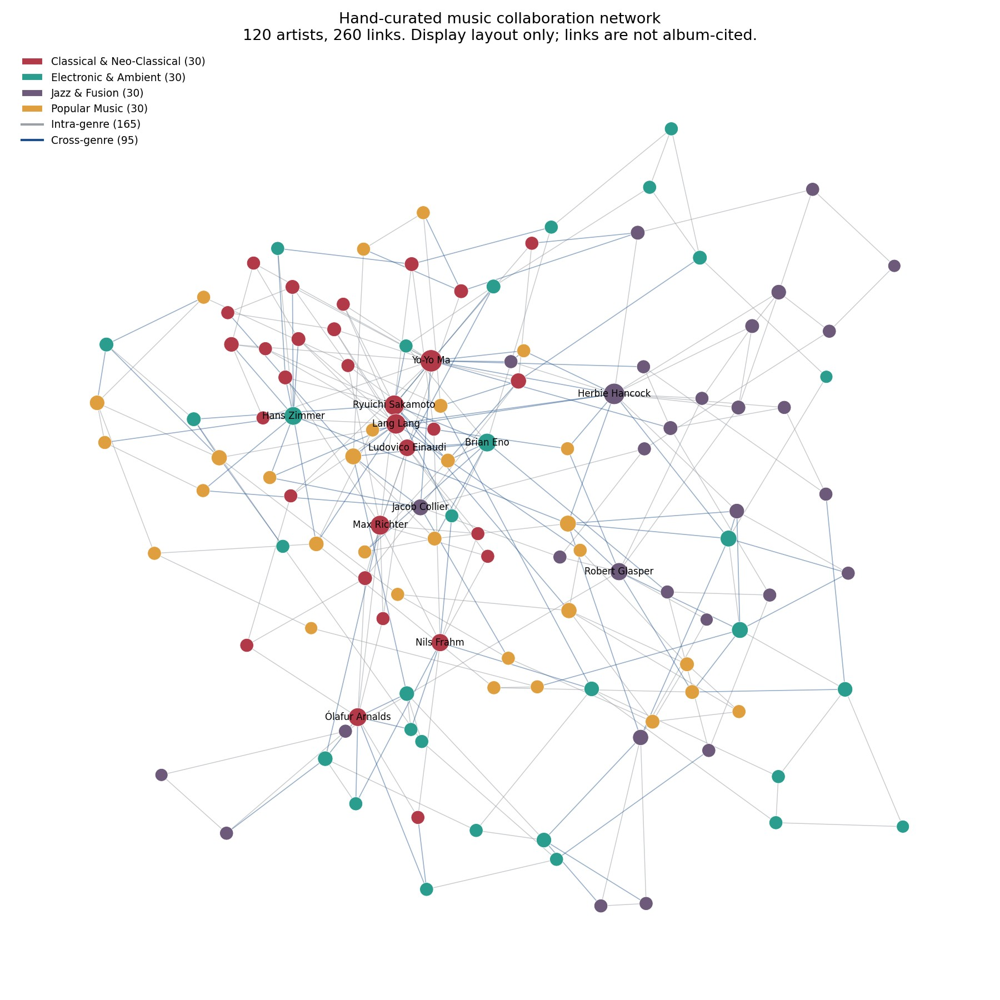
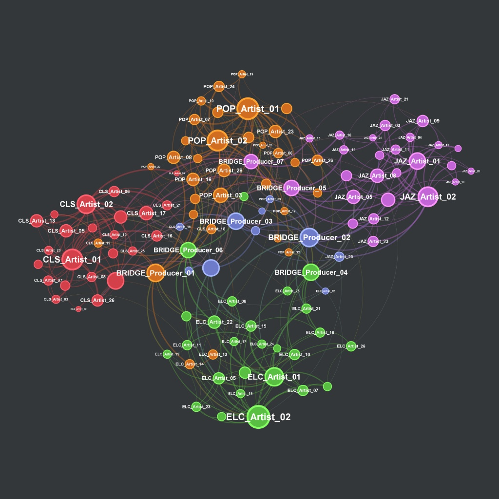

# Digital Music Community & Cross-Genre Artist Collaboration Network Mining via Complex Network Theory

**Graph measures on a hand-curated sample of 120 recording artists: genre cohesion, Louvain modularity, and Burt's structural holes. This is not a map of global music collaboration.**

---

## Network Topology Visual Analytics


*Figure 1: Hand-curated collaboration network (|V|=120, |E|=260). Node size is proportional to degree. Gray edges are intra-genre and blue edges are cross-genre. The layout is only a display sketch; it is not a ForceAtlas2 or Gephi export, and it does not verify the links.*

---

## 1. Project Overview & Theoretical Background

In contemporary digital music ecosystems, artistic innovation increasingly emerges at the intersection of distinct stylistic traditions. While traditional musicological analysis examines stylistic fusion through harmonic or timbral frameworks, **Computational Social Science (CSS)** and **Complex Network Theory** offer a rigorous mathematical lens to quantify how creative influence propagates across genre boundaries.

This research project models a hand-curated sample of 120 recording artists as one undirected, weighted collaboration graph $G = (V, E, W)$, where vertices $v_i \in V$ represent recording artists or producers, edges $e_{ij} \in E$ denote hand-curated collaboration links, not a complete discography, and edge weights $w_{ij} \in W$ capture collaboration intensity. By integrating **parametric generative network benchmarking** with **network measures on that curated sample**, this study addresses two foundational research questions in cultural sociology and network science:

1. **Community Homophily vs. Cross-Boundary Brokerage**: How strongly do stylistic norms partition recording artists into insular genre clusters (measured via **Blondel et al.'s Louvain Modularity $Q$** and **Watts–Strogatz local transitivity**), and which structural actors bridge these divides?
2. **Structural Holes and Creative Arbitrage**: Drawing upon **Ronald S. Burt's (1992, 2004) Theory of Structural Holes**, how do cross-genre producers and boundary-spanning instrumentalists (e.g., *Yo-Yo Ma*, *Ryuichi Sakamoto*, *Hans Zimmer*, *Brian Eno*, *Herbie Hancock*, *Lang Lang*) leverage **low network constraint ($C_i$)** and **high non-redundant effective size ($ES_i$)** to broker musical diffusion across Classical, Electronic/Ambient, Jazz/Fusion, and Popular Music communities?

---

## 2. Methodological framework: simulation benchmark vs. hand-curated sample

A frequent limitation in exploratory network studies is evaluating network metrics on one sample without a baseline without a controlled baseline. To establish methodological rigor, `music_network_mining.py` implements a **Dual-Pipeline Architecture** controllable via a unified CLI and programmatic interface (`main(mode='simulation')` vs. `main(mode='real')`):

| Analytical Dimension | Pipeline A: Generative simulation benchmark (`mode='simulation'`) | Pipeline B: Hand-curated sample (`mode='real'`) |
| :--- | :--- | :--- |
| **Epistemological Role** | Null/Synthetic Structural Baseline (Controlled Small-World + Scale-Free Topology) | Metrics computed on a hand-curated 120-artist sample |
| **Network Scale** | $|V| = 120$ synthetic nodes, $|E| = 425$ weighted edges | $|V| = 120$ hand-curated recording artists, $|E| = 260$ weighted edges |
| **Genre Architecture** | 4 canonical macro-genres (`CLS`, `POP`, `JAZ`, `ELC`) + 8 dedicated `BRIDGE_Producer` nodes | 4 macro-genres spanning 30 Classical/Neo-Classical, 30 Electronic/Ambient, 30 Jazz/Fusion, and 30 Popular Music artists |
| **Graph Density ($\rho$)** | $0.0595$ | $0.0364$ |
| **Average Clustering ($\langle C \rangle$)** | $0.2041$ | $0.2704$ (Elevated local triadic closure in real studio cliques) |
| **Louvain Modularity ($Q$)** | $Q = 0.5479$ across $6$ communities | $Q = 0.6319$ across $10$ communities |
| **Primary Broker Signature** | The eight planted `BRIDGE_Producer` nodes have Burt constraint from $0.0704$ to $0.1054$, and local clustering at most $0.0758$ | In this sample the lowest constraints are *Lang Lang* $C_i = 0.1209$, *Yo-Yo Ma* $C_i = 0.1283$, *Robert Glasper* $C_i = 0.1314$, and *Ryuichi Sakamoto* $C_i = 0.1366$ |

### Visual comparison: hand-curated sample vs. synthetic benchmark
<p align="center">
  
  
</p>
<p align="center">
  <em>Figure 2: Left: the same hand-curated 120-artist sample (|V|=120, |E|=260). Right: a synthetic benchmark drawn separately (|V|=120, |E|=425). The two pictures use different layouts and should not be read as the same algorithm.</em>
</p>

### Why compare the simulation with the hand-curated sample?
1. **Algorithmic Verification**: The synthetic benchmark (`mode='simulation'`) plants 8 explicit `BRIDGE_Producer` nodes with known cross-community attachment probabilities and 8 intra-genre `Genre Hub` nodes. Confirming that Burt's Constraint ($C_i$) and Effective Size ($ES_i$) accurately separate `BRIDGE_Producer` brokers from insular hubs validates the mathematical pipeline before it is applied to the hand-curated sample.
2. **Sociological Contrast**: Comparing the synthetic baseline with the hand-curated sample (`mode='real'`) shows **higher modularity ($Q = 0.6319$ vs. $0.5479$)** and **32.5% higher local clustering ($\langle C \rangle = 0.2704$ vs. $0.2041$)**. Those two differences describe this sample only. After shortest paths treat a stronger collaboration as a shorter step, the highest betweenness is Herbie Hancock, not a classical soloist.

---

## 3. Mathematical Formulations & Computational Social Science Metrics

All metrics are computed in `music_network_mining.py` and exported to both `output/music_network_metrics_v2.csv` and node attributes inside `output/music_network_advanced.gexf`.

### 3.1 Classical Centrality & Local Transitivity
- **Normalized Degree Centrality ($C_D$)**: Quantifies direct collaboration volume relative to network capacity:
  $$C_D(i) = \frac{k_i}{N - 1}$$
- **Betweenness centrality ($C_B$)**: Measures how often artist $i$ lies on shortest paths between other artist pairs $(s, t)$, using Brandes' (2001) algorithm. The stored weight is collaboration intensity. Path length uses $d_{ij} = 1/w_{ij}$, so a stronger collaboration is a shorter step. Closeness below counts hops and ignores weights. Burt constraint and Louvain modularity still treat $w_{ij}$ as tie strength.
  $$C_B(i) = \frac{2}{(N-1)(N-2)} \sum_{s \neq i \neq t} \frac{\sigma_{st}(i)}{\sigma_{st}}$$
- **Closeness centrality ($C_C$)**: Counts unweighted hops inside this sample, not distance based on collaboration strength:
  $$C_C(i) = \frac{N - 1}{\sum_{j \neq i} d(i, j)}$$
- **Local Clustering Coefficient ($C_i^{\text{clust}}$)**: Captures triadic closure (the probability that two collaborators of artist $i$ have also collaborated with one another):
  $$C_i^{\text{clust}} = \frac{2 |\text{triangles}(i)|}{k_i (k_i - 1)}$$

### 3.2 Blondel et al.'s Louvain Community Detection & Modularity ($Q$)
To uncover latent genre and sub-genre communities without relying on a priori labels, the pipeline applies the multi-level **Louvain Modularity Optimization** algorithm, maximizing Newman–Girvan weighted modularity $Q$:
$$Q = \frac{1}{2m} \sum_{i,j} \left[ A_{ij} - \frac{k_i k_j}{2m} \right] \delta(c_i, c_j)$$
where $A_{ij}$ is the collaboration weight between artists $i$ and $j$, $k_i = \sum_v A_{iv}$ is the weighted degree of node $i$, $m = \frac{1}{2}\sum_{i,j} A_{ij}$, and $\delta(c_i, c_j) = 1$ if artists $i$ and $j$ are assigned to the same `Modularity_Class` community.

### 3.3 Ronald Burt's Structural Holes Theory (`Constraint` & `Effective_Size`)
In computational sociology, high degree alone does not guarantee innovative brokerage; an artist embedded in a dense clique receives redundant information. Following **Burt (1992)**, let $p_{ij}$ denote the proportional strength of artist $i$'s collaboration tie with artist $j$:
$$p_{ij} = \frac{w_{ij}}{\sum_{k \in N(i)} w_{ik}}$$

1. **Network Constraint ($C_i$)**: Measures the extent to which artist $i$'s ego network is directly or indirectly invested in mutually interconnected alters:
   $$C_i = \sum_{j \in N(i)} \left( p_{ij} + \sum_{q \in N(i), q \neq i, j} p_{iq} p_{qj} \right)^2$$
   *Sociological Interpretation*: **Lower $C_i$** signifies that artist $i$'s collaborators are disconnected from one another, placing artist $i$ across a **Structural Hole** with high cross-genre brokerage power.
2. **Non-Redundant Effective Size ($ES_i$)**: Quantifies the non-redundant breadth of an artist's collaboration portfolio:
   $$ES_i = \sum_{j \in N(i)} \left[ 1 - \sum_{q \neq i,j} p_{iq} m_{jq} \right], \quad \text{where } m_{jq} = \frac{w_{jq}}{\max_k w_{jk}}$$
   *Sociological Interpretation*: **Higher $ES_i$** relative to raw degree $k_i$ indicates an expansive, non-overlapping creative network spanning distinct musical communities.

---

## 4. Findings on the hand-curated sample (`mode='real'`)

Running `mode='real'` on `data/real_artist_edgelist.csv` ($|V|=120, |E|=260$) yields the following top cross-genre brokers and structural hole spanners:

| Rank | Artist Name | Macro-Genre Classification | Role | Degree ($k_i$) | Betweenness ($C_B$) | Closeness ($C_C$) | Burt Constraint ($C_i$) | Effective Size ($ES_i$) | Louvain Class |
| :---: | :--- | :--- | :--- | :---: | :---: | :---: | :---: | :---: | :---: |
| **1** | **Herbie Hancock** | Jazz & Fusion | Genre Hub | 15 | **0.1926** | 0.3606 | 0.1315 | 13.6414 | 4 |
| **2** | **Yo-Yo Ma** | Classical & Neo-Classical | Genre Hub | 17 | **0.1257** | 0.3902 | 0.1283 | 15.7882 | 0 |
| **3** | **Coldplay** | Popular Music | Genre Hub | 7 | 0.1229 | 0.3459 | 0.1754 | 6.7 | 0 |
| **4** | **Lang Lang** | Classical & Neo-Classical | Genre Hub | 13 | 0.1153 | 0.3673 | **0.1209** | 12.2738 | 0 |
| **5** | **Brian Eno** | Electronic & Ambient | Bridge Producer | 10 | 0.1006 | 0.3362 | 0.1981 | 9.0427 | 1 |
| **6** | **Robert Glasper** | Jazz & Fusion | Bridge Producer | 9 | 0.0951 | 0.2953 | 0.1314 | 8.75 | 3 |
| **7** | **Ryuichi Sakamoto** | Classical & Neo-Classical | Bridge Producer | 13 | 0.0916 | 0.3707 | 0.1366 | 12.2281 | 1 |
| **8** | **Jacob Collier** | Jazz & Fusion | Bridge Producer | 7 | 0.0806 | 0.3362 | 0.222 | 6.6333 | 0 |

### Key Analytical Takeaways
- **Bridges inside this 120-artist sample**: With stronger collaborations treated as shorter paths, **Herbie Hancock** has the highest betweenness ($C_B = 0.1926$). **Yo-Yo Ma** is second ($C_B = 0.1257$, $ES_i = 15.7882$). **Lang Lang** does not lead betweenness ($C_B = 0.1153$) but still has the lowest constraint in the sample ($C_i = 0.1209$). These ranks describe only the 120 names in the file.
- **Ryuichi Sakamoto is not the second betweenness bridge after this correction.** His betweenness is $C_B = 0.0916$, seventh in this sample. Across 13 ties his effective size is $12.2281$ (94.1% of his degree) and his constraint is $0.1366$. The links still reach Alva Noto, Fennesz, Brian Eno, Yo-Yo Ma, Max Richter, Jóhann Jóhannsson, and SUGA, who is filed under Popular Music.

---

## 5. Data Architecture & Gephi Visual Analytics Pipeline

### 5.1 Repository Structure
```text
digital-music-network-mining/
├── data/
│   └── real_artist_edgelist.csv          # Hand-curated edge list (120 artists, 260 weighted edges)
├── output/
│   ├── music_network_metrics_v2.csv      # Enriched node-level sociological metrics table (11 columns)
│   └── music_network_advanced.gexf       # GEXF 1.2 topology file with embedded node/edge attributes
├── docs/
│   └── figures/
│       ├── music_network_topology.jpg              # Hand-curated network drawing
│       └── music_network_topology_simulation.jpg   # Synthetic benchmark baseline topology
├── music_network_mining.py               # Main Dual-Pipeline Complex Network Mining Engine
├── requirements.txt                      # Python scientific computing dependencies
├── .gitignore                            # Enterprise Git exclusion rules
└── README.md                             # Project documentation & theoretical manual
```

### 5.2 Gephi Visualization Workflow
The exported `music_network_advanced.gexf` file adheres strictly to the GEXF 1.2 XML schema with pre-bound `integer` and `double` attribute declarations:
1. **Import**: Open `output/music_network_advanced.gexf` in **Gephi (v0.10+)** as an *Undirected Graph*.
2. **Node Color Partitioning (Community Detection)**:
   - Navigate to `Appearance -> Nodes -> Color -> Partition`.
   - Select **`Modularity_Class`** (computed via Louvain algorithm) or **`genre`** to color-code communities.
3. **Node Size Ranking (Brokerage & Structural Holes)**:
   - Navigate to `Appearance -> Nodes -> Size -> Ranking`.
   - Select **`Betweenness_Centrality`** or **`Effective_Size`** (Min Size: `12`, Max Size: `65`) to visually amplify cross-genre bridges.
4. **Layout Optimization**:
   - Execute **ForceAtlas2** (`Scaling = 15.0`, `Gravity = 1.0`, enable `Dissuade Hubs` and `Prevent Overlap`) or **Yifan Hu Proportional** to achieve clear community separation with central bridge suspension.

---

## 6. Step-by-Step Reproducibility Guide

### 6.1 Environment Setup
```bash
# Clone the repository
git clone https://github.com/shendove666-ai/digital-music-network-mining.git
cd digital-music-network-mining

# Create and activate a virtual environment
python3 -m venv .venv
source .venv/bin/activate  # On Windows: .venv\Scripts\activate

# Install scientific dependencies
pip install -r requirements.txt
```

### 6.2 Running the Dual-Pipeline Engine
1. **Run the hand-curated sample (`mode='real'`, default)**:
   ```bash
   python3 music_network_mining.py \
       --mode real \
       --input data/real_artist_edgelist.csv \
       --gexf output/music_network_advanced.gexf \
       --csv output/music_network_metrics_v2.csv
   ```
2. **Execute Generative Simulation Benchmark (`mode='simulation'`)**:
   ```bash
   python3 music_network_mining.py \
       --mode simulation \
       --gexf output/music_network_simulation_advanced.gexf \
       --csv output/music_network_metrics_simulation_v2.csv \
       --seed 42
   ```
3. **Programmatic Import in Python / Jupyter**:
   ```python
   from music_network_mining import main

   # Run the hand-curated sample
   real_metrics = main(mode="real")

   # Run synthetic benchmark pipeline
   sim_metrics = main(mode="simulation", seed=42)
   ```

---

## 7. Academic References & Citations

1. **Burt, R. S.** (1992). *Structural Holes: The Social Structure of Competition*. Harvard University Press.
2. **Burt, R. S.** (2004). Structural holes and good ideas. *American Journal of Sociology*, 110(2), 349–399.
3. **Blondel, V. D., Guillaume, J. L., Lambiotte, R., & Lefebvre, E.** (2008). Fast unfolding of communities in large networks. *Journal of Statistical Mechanics: Theory and Experiment*, 2008(10), P10008.
4. **Brandes, U.** (2001). A faster algorithm for betweenness centrality. *Journal of Mathematical Sociology*, 25(2), 163–177.
5. **Newman, M. E. J.** (2006). Modularity and community structure in networks. *Proceedings of the National Academy of Sciences*, 103(23), 8577–8582.
6. **Watts, D. J., & Strogatz, S. H.** (1998). Collective dynamics of 'small-world' networks. *Nature*, 393(6684), 440–442.
7. **Uzzi, B., & Spiro, J.** (2005). Collaboration and creativity: The small world problem. *American Journal of Sociology*, 111(2), 447–504.
